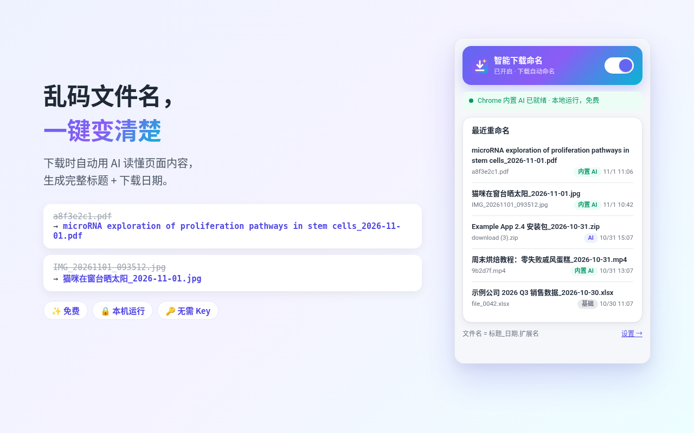

# 智能下载命名 · SmartName Downloads

Chrome 扩展（Manifest V3，**v1.2.5**）。浏览器一开始保存下载，就把乱码文件名换成**完整、可读的标题**，并加上下载日期 `_YYYY-MM-DD`。

`a8f3e2c1.pdf` → `Oral Nirmatrelvir for High-Risk, Nonhospitalized Adults with Covid-19_2026-11-01.pdf`



## 它做什么

论文、文章、图片、视频、安装包经常以 `a8f3e2c1.pdf`、`IMG_20261101_093512.jpg`、`download (3).zip` 落地。本扩展在 `downloads.onDeterminingFilename` 阶段给出新文件名：能找到真实标题时**原样保留、不截断、不概括**；没有标题时才生成一句简短描述。日期格式可选 `YYYY-MM-DD` 或 `YYYYMMDD`。重名自动加 `(1)`、`(2)`。AI 超时（约 8 秒）或不可用时，立刻改用页面标题或原文件名，下载不会卡住。

## 功能

- **Chrome 内置 AI（默认）**：Gemini Nano 在本机运行，免费、无需账号、无需 API Key。需要桌面版 Chrome 138+ 以及足够的磁盘和内存；首次在设置页下载内置模型。
- **自己的 API（可选）**：可填 OpenAI 兼容接口的 Key，例如 DeepSeek、OpenAI、xAI，或任意自定义端点。Key 只写在本机 `chrome.storage.local`。
- **增强识别（可选）**：授权读取网站后，用页面上的 `citation_title` / `DC.Title` / `og:title`、你点击的图片说明或链接文字，以及 PDF 内嵌标题。像论文时，只把公开的 PMC/PubMed 编号发给 NCBI E-utilities，或把 DOI 发给 Crossref，取回官方标题。
- **基础命名**：上述都不可用时，用下载地址、来源页、原文件名和 MIME 类型拼一个仍然带日期的名字。

设置页可以选「自动（推荐）」「内置 AI」或「自己的 API」。

## 权限与隐私

安装时的权限提示只有「管理下载内容」。`storage` 保存设置和最近 5 条重命名；`offscreen` 让内置 AI 在服务工作进程之外本地运行；`scripting` 只在你打开增强识别之后注册脚本。访问 DeepSeek / OpenAI / xAI 或任意网站，都是点保存或打开增强识别时才申请。

默认路径在你的电脑上完成命名，不经过本扩展的服务器（本扩展没有服务器）。开启「自己的 API」后，文件地址、来源页、原文件名和类型会发给**你选择的**服务商，只为生成文件名。增强识别向 NCBI / Crossref 发送的只有公开文献编号，不含 Cookie 和文件内容。

完整说明：<https://shuhaofan50-fan.github.io/smartname-downloads/privacy.html>（仓库里的页面是 [`docs/privacy.html`](docs/privacy.html)）。权限对照表在 [`store/permissions.md`](store/permissions.md)。

## 安装

**Chrome 网上应用店：** 即将上架 / Coming soon to Chrome Web Store

**手动安装（Load unpacked）：**

1. 克隆本仓库。
2. 打开 `chrome://extensions`，打开右上角「开发者模式」。
3. 选择「加载已解压的扩展程序」，指向本仓库的 `extension/` 文件夹。
4. 在工具栏拼图菜单里把「智能下载命名」固定出来。

Safari 没有在下载时修改文件名的接口，因此本扩展不支持 Safari。

## 开发与测试

运行时没有第三方依赖，测试用 Node.js 自带模块（建议 Node 20+，持续集成使用 Node 22）。

```bash
cd extension
node --check lib.js
node --check background.js
node --check popup.js
node --check options.js
node --check content.js
node --check offscreen.js
node --check welcome.js
node test/lib.test.js
node test/sw-listener.test.js
```

推送和 Pull Request 会跑上述检查（[`.github/workflows/package.yml`](.github/workflows/package.yml)）。推送 `v*` 标签时，工作流把 `extension/` 打成 zip（清单文件在压缩包根目录，不含 `test/` 和 `scripts/`）并挂到对应的 GitHub Release。

商店文案、权限说明和截图在 [`store/`](store/)（Markdown 与截图，给维护者更新上架信息用）。项目页在 [`docs/`](docs/)，由 `main` 分支的 `/docs` 提供。

## 许可证

[MIT](LICENSE)。Copyright (c) 2026 Fan (shuhaofan50-fan)。

---

# SmartName Downloads – AI File Renamer

A Chrome extension (Manifest V3, **v1.2.5**). When the browser saves a download, SmartName replaces the cryptic filename with the **full, readable title** plus the download date `_YYYY-MM-DD`.

`a8f3e2c1.pdf` → `Oral Nirmatrelvir for High-Risk, Nonhospitalized Adults with Covid-19_2026-11-01.pdf`


## What it does

Papers, articles, images, videos, and installers often land as `a8f3e2c1.pdf`, `IMG_20261101_093512.jpg`, or `download (3).zip`. The extension suggests a new name from `downloads.onDeterminingFilename`. A real title is kept **in full — it is neither truncated nor summarized**. A short description is generated only when there is no title. The date format is `YYYY-MM-DD` or `YYYYMMDD`. Duplicate names get `(1)`, `(2)`, and so on. If AI is unavailable or takes longer than about 8 seconds, naming falls back to the page title or the original filename immediately, so the download is never stuck.

## Features

- **Chrome built-in AI (default).** Gemini Nano runs on your computer: free, no account, no API key. Requires desktop Chrome 138+ and enough disk and memory. Download the on-device model once from the options page.
- **Your own API (optional).** An OpenAI-compatible key — DeepSeek, OpenAI, xAI, or any custom endpoint. The key stays in `chrome.storage.local` on this device.
- **Enhanced recognition (optional).** After you allow site access, names can use `citation_title` / `DC.Title` / `og:title`, the alt text or link text you clicked, and a PDF's embedded title. For scholarly files, only the public PMC/PubMed id is sent to NCBI E-utilities, or the DOI to Crossref, to fetch the official title.
- **Basic naming.** When none of the above is available, the name still gets a date, built from the download URL, referrer, original filename, and MIME type.

The options page offers Automatic (recommended), Built-in AI, or Your own API.

## Permissions and privacy

The install prompt asks only to manage downloads. `storage` keeps settings and the last 5 renames; `offscreen` runs the built-in model outside the service worker; `scripting` registers a content script only after Enhanced recognition is turned on. Host access for DeepSeek, OpenAI, xAI, or all sites is requested when you save a key or enable Enhanced recognition.

By default the name is produced on your computer. The extension has no server of its own. If you add your own API, the file URL, referrer, original filename, and type are sent only to the provider you chose, and only to generate the name. NCBI / Crossref receive a public identifier, not cookies or file contents.

Full policy: <https://shuhaofan50-fan.github.io/smartname-downloads/privacy.html> (source page: [`docs/privacy.html`](docs/privacy.html)). Permission notes: [`store/permissions.md`](store/permissions.md).

## Install

**Chrome Web Store:** 即将上架 / Coming soon to Chrome Web Store

**Manual install (Load unpacked):**

1. Clone this repository.
2. Open `chrome://extensions` and turn on Developer mode.
3. Choose **Load unpacked** and select the `extension/` folder.
4. Pin SmartName from the toolbar puzzle menu.

Safari cannot rename a file at download time, so this extension does not support Safari.

## Development and tests

There are no third-party runtime dependencies. Tests use the Node.js standard library (Node 20+ locally; CI uses Node 22).

```bash
cd extension
node --check lib.js
node --check background.js
node --check popup.js
node --check options.js
node --check content.js
node --check offscreen.js
node --check welcome.js
node test/lib.test.js
node test/sw-listener.test.js
```

Pushes and pull requests run those checks ([`.github/workflows/package.yml`](.github/workflows/package.yml)). Pushing a `v*` tag zips `extension/` with `manifest.json` at the archive root, omits `test/` and `scripts/`, and attaches the zip to a GitHub Release.

Store listing copy and screenshots live in [`store/`](store/) for maintainers. The project site lives in [`docs/`](docs/) and is served from the `main` branch `/docs` folder.

## License

[MIT](LICENSE). Copyright (c) 2026 Fan (shuhaofan50-fan).
